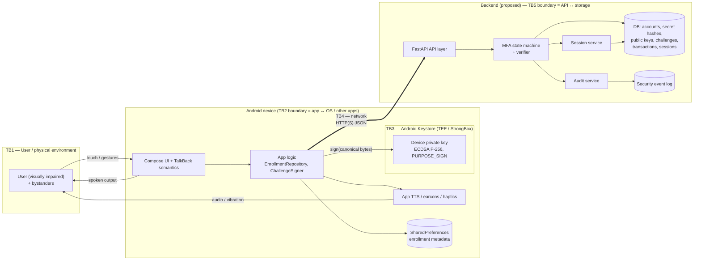

# 08. Threat Model

* **Project:** Miranova Accessible Multi-Factor Authentication
* **Document owner:** De Silva N. N. B. (`@Nimsika-Bosilu`) — Threat Modeling & Security Evaluation
* **Related issues:** #38 (this document), #57 (adversarial security tests), #58 (security-control evaluation)
* **Related documents:** MiraNova SRS (MN-SRS-001 v0.1, `SRS.md`) §6, §10–§12, [`09-security-controls.md`](09-security-controls.md), [`01-assumptions.md`](01-assumptions.md), [ADR-003](adr/ADR-003-android-keystore.md), [ADR-005](adr/ADR-005-accessibility-strategy.md)
* **Version:** 0.1 — team review draft
* **Last updated:** 2026-10-13

> **Status of this model.** This document models the code on the `dev` branch at commit `d1948ee` (Android client after PR #68). It also models the **proposed** backend contract in SRS §10.3. The FastAPI backend has **not been implemented yet** (issues #40, #42, #44–#49 are open). Every backend control below is therefore a **planned control**, not an observed one. Implementation status and test evidence are tracked in [`09-security-controls.md`](09-security-controls.md). Issue #58 will update them after the #57 tests have run.
>
> **Wording rule (SRS §12.1, NFR-S09):** this document says that a control *reduces*, *detects* or *is intended to reject* an attack. It does not say a control *prevents* an attack unless test evidence supports that claim.

---

## 1. Scope and method

### 1.1 In scope

* Android client: `android-app/` (Compose UI, Android Keystore signing, enrollment/re-enrollment, TTS/haptics, networking).
* Authentication API and MFA decision engine (FastAPI, proposed): enrollment, knowledge factor, device challenge/response, sessions, protected resource, logout (SRS §10.3).
* Persistence: accounts, device public keys, challenges, transactions, sessions, security events (SRS §11).
* Accessibility channels used as security-relevant interfaces: TalkBack semantics, app TTS, haptics.
* The repository itself, as a channel through which secrets can leak.

### 1.2 Out of scope

These are not modelled in detail. The related residual risks are summarised in §9.

* A full compromise of the Android OS or kernel, a hardware side-channel, or a physical attack on the TEE/StrongBox.
* Compromise of the developer machines, GitHub, or the build toolchain (supply chain).
* Production deployment, identity proofing/KYC, and internet-scale denial of service (SRS §4.2).
* Voice-biometric matching, which is excluded from the MVP (SRS §2.3 DEC-01, ADR-005). See §7.

### 1.3 Method

1. Build a data-flow model with explicit **trust boundaries** (§2).
2. List **assets** (§3), **attackers** (§4) and **entry points** (§5).
3. Apply **STRIDE per element** (Spoofing, Tampering, Repudiation, Information disclosure, Denial of service, Elevation of privilege) to each element and each boundary crossing [REF-THR-01].
4. Write **abuse cases** for the highest-risk paths (§6.2).
5. Rate each threat with a simple qualitative **Likelihood × Impact** scale (High / Medium / Low). The rating reflects the academic-prototype context (ASM-04). It is not a quantitative risk score.
6. Map each threat to SRS threat IDs (TH-01…TH-13), security objectives (§8), planned controls ([`09-security-controls.md`](09-security-controls.md)) and a verification test (`SEC-xx` in `tests/security/`, implemented under #57, or an SRS `TC-xx`).
7. Review the code on `dev` against the model and record concrete **design findings** (§10).

---

## 2. System model and trust boundaries

**Figure 1.** MiraNova data-flow diagram with trust boundaries TB1–TB5 (component names from SRS §6.1).

| Boundary | Crossing | Why it matters |
| :--- | :--- | :--- |
| **TB1** User ↔ device | Touch input, TalkBack speech, TTS audio, haptics | Bystanders can see and hear output (shoulder surfing, acoustic eavesdropping). A user can be socially engineered into approving a request. |
| **TB2** App ↔ OS / other apps | SharedPreferences, accessibility services, overlays, backups | Other apps and accessibility services run with different privileges. A rooted device or malware can read app storage. |
| **TB3** App ↔ Android Keystore | `sign()` calls and the key-generation policy | The private key is intended to stay inside the Keystore. The app can only ask the Keystore to sign. It cannot read the key. |
| **TB4** Device ↔ network ↔ API | All REST calls | This is an untrusted network. **The server must treat every client-supplied field as attacker-controlled** (SRS §6.1). |
| **TB5** API ↔ storage / logs | DB queries, log writes | Disclosure of the DB or logs must not reveal secrets, private keys or usable tokens. |

**Authority rule (FR-02):** only the server decides whether MFA succeeded. Factor flags, "enrolled" state, timestamps and the hardware security level reported by the client are untrusted inputs.

---

## 3. Assets

| ID | Asset | Location | Security property needed | Sensitivity (SRS §11.1) |
| :--- | :--- | :--- | :--- | :--- |
| A-01 | Knowledge secret (password / PIN) | User memory; in transit; server stores only a salted hash | Confidentiality | Secret/authentication |
| A-02 | Device private key | Android Keystore only | Confidentiality, controlled use | Secret/authentication |
| A-03 | Registered device public keys and device status | Server DB | Integrity (binding account ↔ device) | Internal |
| A-04 | Challenges / nonces | Server DB, in transit, client screen | Unpredictability, single use, binding, freshness | Internal |
| A-05 | Authentication transaction state (which factors passed) | Server only | Integrity | Internal |
| A-06 | Session / access tokens | Server (hash or JTI), client storage, in transit | Confidentiality, integrity, expiry | Secret/authentication |
| A-07 | Account identifiers (usernames) | Server DB, client SharedPreferences | Confidentiality against enumeration | Internal |
| A-08 | Security / audit log | Server | Integrity, minimisation, restricted access | Audit/security |
| A-09 | Protected resource (`GET /v1/me`) | Server | Access only after full MFA | Internal |
| A-10 | Accessible output channel (TalkBack / TTS / haptics) | Device ↔ user | Integrity of what the user is told. No secrets spoken. | — |
| A-11 | Repository and configuration secrets (JWT signing key, DB credentials) | Developer machines, `.env`, CI | Confidentiality | Secret/authentication |

---

## 4. Attackers and capabilities

| ID | Attacker | Capabilities assumed | Not assumed |
| :--- | :--- | :--- | :--- |
| AT-01 | **Remote network attacker** | Can call every public API endpoint directly with any HTTP client. Can script many requests. Knows the public API contract and the source code (open repository). | Already knows the user's secret or holds the device |
| AT-02 | **On-path attacker (shared Wi-Fi / demo network)** | Can observe, modify and replay traffic that is not protected by validated TLS | Can break correctly configured TLS |
| AT-03 | **Bystander / eavesdropper** | Can see the screen and hear TalkBack/TTS output nearby. Can record audio. | Has the device |
| AT-04 | **Thief of a locked phone** | Has the device, but not the screen-lock credential or the knowledge secret | Can bypass the OS lock screen |
| AT-05 | **Holder of an unlocked phone / malicious local app** | Can run the app UI, invoke app functions, read app-private storage on a rooted device, and draw overlays | Can export Keystore keys from hardware |
| AT-06 | **Malicious or modified client** | Can send forged factor flags, out-of-order calls and arbitrary JSON fields | — |
| AT-07 | **DB / log disclosure** | Gets a read-only copy of the DB or the logs (e.g. from a misconfigured demo host or a committed file) | Can change running server code |
| AT-08 | **Insider / careless developer** | Accidentally commits secrets or logs sensitive values | Acts maliciously on purpose |

---

## 5. Entry points

| ID | Entry point | Trust boundary | Exposed to |
| :--- | :--- | :--- | :--- |
| EP-01 | `GET /health` | TB4 | AT-01 |
| EP-02 | `POST /v1/accounts` (bootstrap) | TB4 | AT-01, AT-06 |
| EP-03 | `POST /v1/devices/enrollment-challenge`, `POST /v1/devices/register` | TB4 | AT-01, AT-06 |
| EP-04 | `POST /v1/auth/start`, `POST /v1/auth/verify-secret` | TB4 | AT-01, AT-06 |
| EP-05 | `POST /v1/auth/device-challenge`, `POST /v1/auth/device-verify` | TB4 | AT-01, AT-02, AT-06 |
| EP-06 | `GET /v1/me`, `POST /v1/auth/logout` | TB4 | AT-01, AT-02 |
| EP-07 | Android UI screens (Enrollment, AuthChallenge, ReEnrollment, Settings, Home) | TB1, TB2 | AT-03, AT-05 |
| EP-08 | Keystore `sign()` through `ChallengeSigner` / `KeyLifecycleManager` | TB3 | AT-05 |
| EP-09 | App-private storage (`miranova_enrollment_prefs`, accessibility prefs) | TB2 | AT-05 |
| EP-10 | TalkBack / TTS / haptic output | TB1 | AT-03 |
| EP-11 | Server logs and DB files | TB5 | AT-07, AT-08 |
| EP-12 | Git repository, `.env`, CI configuration | — | AT-08, public readers |

> **Endpoint naming note:** the Android client currently calls `/api/health`, `/api/auth/register`, `/api/auth/challenge`, `/api/auth/verify` and `/api/auth/logout` (`AppConfig.kt`). The SRS proposes `/health` and `/v1/...`. See finding **F-04**. This model uses the SRS names.

---

## 6. Threats

### 6.1 Threat register

**Legend.** **S/T/R/I/D/E** = STRIDE category. **L / I** = likelihood / impact (H/M/L). **P** = priority: **P0** = must be controlled and tested before the demo; **P1** = should be controlled; **P2** = documented residual risk. **CTL-xx** = control in [`09-security-controls.md`](09-security-controls.md). **SEC-xx** = adversarial test in `tests/security/` (#57).

| ID | STRIDE | SRS | Asset | TB | Threat / abuse case | L | I | P | Planned controls | Verification |
| :--- | :---: | :---: | :--- | :---: | :--- | :---: | :---: | :---: | :--- | :--- |
| **TM-01** | S | TH-01 | A-01 | TB4 | **Online guessing** of the knowledge secret through `verify-secret` | H | M | P0 | CTL-01 slow salted hash; CTL-02 rate limiting / back-off; CTL-03 the device factor is still required | SEC-04, TC-04 |
| **TM-02** | I | TH-10 | A-07 | TB4 | **Account enumeration**: different error bodies, status codes or timings for an unknown user vs. a wrong secret | H | L | P0 | CTL-04 uniform error body and status; dummy hash comparison for unknown users | SEC-04 |
| **TM-03** | S | TH-02 | A-04 | TB4 | **Replay** of a previously accepted signed device proof | M | H | P0 | CTL-05 single-use nonce consumed atomically; CTL-06 server-side expiry | SEC-01, TC-05 |
| **TM-04** | T/E | TH-13 | A-04, A-05 | TB4/TB5 | **Race**: the same proof is submitted in parallel so that both requests pass the "unused" check | M | H | P0 | CTL-05 atomic compare-and-set / row lock on consume | SEC-09, TC-13 |
| **TM-05** | S/T | TH-05 | A-04, A-05 | TB4 | **Context substitution**: a valid signature for transaction/account A is presented for transaction/account B, or a nonce is moved between transactions | M | H | P0 | CTL-07 the signed message binds purpose, transaction ID, account ID, device ID, nonce and expiry; the server rebuilds the message itself (see **F-01**) | SEC-02, TC-06 |
| **TM-06** | S | TH-05 | A-03 | TB4 | **Public-key substitution**: the proof carries an attacker public key (`publicKeyBase64` in `SignedChallengeResponse`) and the server verifies against it | M | H | P0 | CTL-08 verify only against the stored public key of the registered, active `device_id`; ignore client-supplied keys (see **F-02**) | SEC-03 |
| **TM-07** | E | TH-04 | A-05, A-09 | TB4 | **Factor bypass**: call `device-verify` without `verify-secret`, call steps out of order, or send forged `secret_ok`/`factor_passed` flags | M | H | P0 | CTL-09 server-side state machine; unknown fields rejected; a session is issued only in the `DevicePending → Authenticated` transition | SEC-05, TC-03/04 |
| **TM-08** | T/E | TH-04 | A-10 | TB1/TB2 | **Client-declared success**: the app tells the user "Authentication approved. Session established." without the server having verified anything (see **F-07**) | H (current code) | M | P0 | CTL-10 the client shows success only after a server success response containing a session | Code review; TC-11 |
| **TM-09** | S/E | TH-09 | A-03 | TB4 | **Enrollment hijack**: the attacker registers **their own** public key under the victim's username, because the registration payload carries only `username` + `public_key` (see **F-03**, **F-06**) | H | H | P0 | CTL-11 controlled bootstrap (DEC-04): enrollment requires an authenticated enrollment context (knowledge factor, or a one-time operator-issued code), plus CTL-12 proof of possession over a server enrollment challenge | SEC-07, TC-01 |
| **TM-10** | E | TH-09 | A-03 | TB4 | **Recovery / re-enrollment bypass**: "lost device" or re-enrollment replaces the device without re-verification, or the old device stays valid | M | H | P0 | CTL-13 re-enrollment needs the same authorization as first enrollment, plus revocation of the old device (DEC-08); demo-only operator reset is documented | SEC-07, TC-14 |
| **TM-11** | S | TH-03 | A-02, A-09 | TB1 | **Stolen locked phone**: the thief tries to authenticate with the registered device | M | M | P1 | CTL-03 knowledge factor still required; CTL-14 optional per-use user authentication on the key; CTL-15 server-side device revocation | SEC-07 (revoked device), TC-04 |
| **TM-12** | E | TH-03 | A-02 | TB2/TB3 | **Unlocked phone or local malware uses the key as a signing oracle** (the key cannot be exported, but it can still be *used*) | M | M | P1 | CTL-14 per-operation user authentication when `requireBiometric` is chosen; CTL-03 knowledge factor; CTL-15 revocation. Residual risk when user auth is disabled. | Manual device test; documented residual risk |
| **TM-13** | I | TH-06 | A-02 | TB3 | **Private key extraction** from the device (root, backup, memory) | L (HW) / M (emulator) | H | P1 | CTL-16 non-exportable `AndroidKeyStore` key, `PURPOSE_SIGN` only; `allowBackup=false`. **No key attestation**, so the server cannot verify the claimed `hardware_backed` / `security_level` (see **F-03**). | Code review; emulator reports `SOFTWARE` |
| **TM-14** | I/T | TH-07 | A-01, A-06 | TB4 | **MITM / cleartext traffic**: `usesCleartextTraffic="true"` for the whole app, and `AppConfig` defaults to `http://` (see **F-09**) | M (demo Wi-Fi) | H | P0 | CTL-17 TLS with platform certificate validation in any non-local deployment; a Network Security Config that allows cleartext **only** to `10.0.2.2`/localhost in debug; no custom trust managers | Config review; TC-15 |
| **TM-15** | S | TH-07/TH-12 | A-01, A-06 | TB1/TB4 | **Rogue backend**: the base URL is redirected to an attacker server (`AppConfig.updateBaseUrl` accepts any `http(s)` URL; it is not called from the UI on `dev`, only from `AppConfigTest`, but it would become an attack path if exposed in Settings), which then collects the secret and relays it | L | H | P1 | CTL-17; release builds use a fixed HTTPS base URL; a runtime URL override is debug-only | Code review |
| **TM-16** | S/E | TH-08 | A-06 | TB4 | **Token forgery / tampering / algorithm confusion** (`alg: none`, HS/RS confusion, modified claims) | M | H | P0 | CTL-18 server-pinned algorithm, signature check, `exp`/`iat`/`aud` validation, account status check | SEC-06, TC-07 |
| **TM-17** | S | TH-08 | A-06 | TB2/TB4 | **Token theft and reuse** (from logs, insecure storage or the network) and **reuse after logout** | M | H | P0 | CTL-19 short-lived tokens; server-side revocation on logout (DEC-07); token kept only in memory or encrypted storage on the client; CTL-20 tokens never logged | SEC-06, TC-08 |
| **TM-18** | I | TH-06 | A-01, A-03, A-06 | TB5 | **DB disclosure** reveals usable secrets or tokens | L | H | P1 | CTL-01 hashes only; CTL-21 store a hash of the session token / JTI, not the bearer token; no private keys server-side; least-privilege DB user | TC-12 (DB inspection) |
| **TM-19** | I | FR-42 | A-01, A-06, A-08 | TB5 | **Log leakage** of passwords, bearer tokens, signatures or raw request bodies | M | H | P0 | CTL-20 structured audit events with an allow-list of fields; redaction; no request-body logging on auth routes | SEC-10, TC-12 |
| **TM-20** | I | FR-44, NFR-S04 | A-08, A-10 | TB4/TB1 | **Diagnostic leakage to the user or bystanders**: server error bodies and exception messages are put into user-facing strings and can be spoken aloud (see **F-10**) | M | M | P1 | CTL-22 generic public errors with a `request_id`; the client maps error codes to fixed accessible messages | SEC-04 (error body), code review |
| **TM-21** | S | TH-12 | A-10, A-09 | TB1 | **Accessibility social engineering / approval fatigue**: the user gets repeated or unexpected "approve" prompts, or the prompt shows attacker-chosen origin text, and approves out of habit or confusion. Screen-reader users cannot see visual cues that a sighted user might notice. | M | H | P1 | CTL-23 approval only inside a login that the user started on this device (no unsolicited push approvals); server-defined origin and action text; per-account challenge rate limits; clear spoken context ("You started a sign-in at <time>") | Accessibility review (#56); SEC-04 (rate limit) |
| **TM-22** | I | TH-12 | A-01, A-10 | TB2 | **Malicious accessibility service or overlay** reads the screen or input (accessibility services can read on-screen content) or obscures the approve button (tapjacking) | L | H | P2 | CTL-24 the secret field is a password-type input, so TalkBack treats it as a password (whether characters are spoken depends on the user's "Speak passwords" setting, which must be checked on the demo device); `filterTouchesWhenObscured` on approval controls; residual risk documented | Manual review |
| **TM-23** | I | TH-11 | A-01, A-04, A-10 | TB1 | **Acoustic eavesdropping**: the secret or tokens are spoken aloud by speech input, TTS or TalkBack | M | M | P1 | CTL-25 no spoken secret entry (ADR-005 §2.2); TTS secrecy filter (`TtsManager.sanitizeUtterance`); no echo of secret values. Note: TalkBack reads the semantic summary, which includes the nonce (see **F-13**). | Unit tests (`TtsManagerTest`), manual TalkBack review |
| **TM-24** | D | TH-10 | A-04, A-05 | TB4/TB5 | **Resource exhaustion**: mass `auth/start` or `device-challenge` calls fill the DB with transactions and challenges | M | L | P2 | CTL-02 rate limits; CTL-06 expiry plus clean-up job | SEC-04 (rate), manual |
| **TM-25** | D | — | A-09 | TB4 | **Targeted lockout**: the attacker deliberately fails logins to lock the victim out | M | M | P2 | CTL-02 temporary back-off instead of permanent lockout; per-IP plus per-account limits | SEC-04 |
| **TM-26** | R | FR-24, FR-42 | A-08 | TB5 | **Repudiation / missing audit trail**: authentication, enrollment, revocation and logout events are not recorded, so attacks cannot be investigated | M | M | P1 | CTL-26 audit events (event type, outcome, reason code, account/transaction ref, request ID, time) without secrets | SEC-10 |
| **TM-27** | T | TH-13 | A-04 | TB4 | **Clock manipulation**: client-supplied timestamps (`CanonicalChallenge.timestamp`, `enrollmentTimestamp`) are used to extend freshness | M | M | P0 | CTL-06 expiry is computed only from server-issued time; client timestamps are ignored for security decisions | SEC-08, TC-06 |
| **TM-28** | I | FR-03 | A-11 | — | **Secrets committed to Git**: the root `.gitignore` is empty, so `.env` is not ignored (see **F-11**) | M | H | P0 | CTL-27 ignore `.env*` except `.env.example`; secret scanning in CI (#43) | SEC-11 |
| **TM-29** | I/E | — | A-09 | TB4 | **Over-broad protected response**: `/v1/me` or error bodies return more than the sanitised profile (hashes, device keys, internal IDs) | L | M | P1 | CTL-22; response models with explicit allow-listed fields | SEC-06 |
| **TM-30** | D/S | — | A-02 | TB3 | **Weakened key policy on fallback**: on the StrongBox-unavailable path the key is regenerated without `setUserAuthenticationParameters(..., AUTH_BIOMETRIC_STRONG or AUTH_DEVICE_CREDENTIAL)` (see **F-12**) | M | L | P1 | CTL-14 one key-policy builder used on every generation path | Code review / unit test |

### 6.2 Abuse cases

Each abuse case is a concrete attacker story for the highest-priority paths.

**AC-01 — Enrollment hijack (TM-09).** AT-01 learns the username of a registered user. On their own phone they install the app (or script the API) and send `POST /api/auth/register` with `username=<victim>` and their own public key. If the server accepts this, the attacker's device becomes a valid possession factor for the victim. If the attacker also guesses or phishes the secret (TM-01), they get full access. *Expected secure behaviour:* registration for an existing account is refused unless it happens inside an authorised enrollment context, and the request is audited.

**AC-02 — Proof replay (TM-03).** AT-02 records a successful `device-verify` request on the demo Wi-Fi and resends it unchanged a minute later. *Expected:* `401/409` with a generic error, because the challenge was already consumed. No session is issued, and an audit event `CHALLENGE_REPLAY` is recorded.

**AC-03 — Parallel double-spend (TM-04).** AT-06 sends the same valid proof 20 times at once. *Expected:* at most **one** request yields a session.

**AC-04 — Skipping the knowledge factor (TM-07).** AT-06, holding a registered device (TM-12), calls `auth/start`, skips `verify-secret`, calls `device-challenge` and `device-verify`, and adds `"secret_verified": true` to the JSON. *Expected:* `device-challenge` is refused for a transaction that is not in state `DevicePending`. Unknown fields are rejected or ignored. No session is issued.

**AC-05 — Key substitution (TM-06).** AT-06 generates a key pair, signs the real server challenge with it, and sends the proof with `public_key=<attacker key>` and the victim's `device_id`. *Expected:* rejected, because the server verifies with the stored key for `device_id`.

**AC-06 — Cross-transaction proof (TM-05).** The attacker opens two login transactions, T1 (victim, attacker-controlled) and T2. They try to use the signed response for T1's nonce in T2. *Expected:* rejected, because the signed message includes the transaction ID and the challenge is looked up per transaction.

**AC-07 — Token after logout (TM-17).** The user logs out. The attacker reuses the copied bearer token on `/v1/me`. *Expected:* `401`, following the logout/revocation model in ADR-004.

**AC-08 — Approval fatigue for a screen-reader user (TM-21).** The attacker knows the victim's secret (TM-01) and repeatedly triggers login so that "Authentication request received… Double tap approve" is announced on the victim's phone. The victim relies on audio and approves one request to make it stop. *Expected (design):* approval is possible only for a login started on the same device. Prompts are rate-limited. The spoken prompt gives the context of who started the request and when.

**AC-09 — Bystander recording (TM-23).** On a bus, AT-03 records the victim's phone audio during login. *Expected:* no secret, PIN digits, token or signature is spoken. The challenge nonce is not a secret, but it should not be read aloud either (F-13).

---

## 7. Speech and voice-related threats

* **Voice biometrics are excluded** from the MVP (SRS §2.3, DEC-01; ADR-005 §1). NIST SP 800-63B-4 does not allow voice as a biometric comparison modality for its authenticators [REF-SEC-02]. Voiceprint spoofing, voice cloning and voiceprint storage therefore **do not apply to the implemented system**. If the team reverses DEC-01, this section must be expanded with recording/replay, synthetic speech spoofing, voiceprint privacy and environmental false-reject risks.
* **Speech input of secrets is prohibited** (ADR-005 §2.2, ASM-ACC-02). The remaining speech-related threats are output-side: TM-23 (TTS/TalkBack reading sensitive values aloud) and TM-21 (spoken prompts used for social engineering).
* The microphone permission is **not** declared in `AndroidManifest.xml` (verified on `dev`). This is consistent with FR-39.

---

## 8. Security objectives

| ID | Objective | Threats addressed | SRS |
| :--- | :--- | :--- | :--- |
| SO-01 | No session is issued unless **both** approved factors have been verified **by the server** in the same unexpired transaction. | TM-07, TM-08, TM-01, TM-11 | FR-02, FR-22, FR-26 |
| SO-02 | Every device challenge is unpredictable, bound to one transaction, account and device, short-lived, and consumable at most once, including under concurrency. | TM-03, TM-04, TM-05, TM-27 | FR-18–FR-21, NFR-S02, NFR-R02 |
| SO-03 | A device becomes a factor for an account only through an authorised enrollment with proof of possession. Revoked devices cannot authenticate. | TM-06, TM-09, TM-10, TM-11 | FR-07, FR-10, FR-12, FR-20 |
| SO-04 | Repeated guessing and enumeration are slowed and give no account-existence signal. | TM-01, TM-02, TM-24, TM-25 | FR-16, FR-17, NFR-S05 |
| SO-05 | Tokens are integrity-protected, short-lived, revocable on logout, and accepted only with the server-pinned algorithm. | TM-16, TM-17 | FR-27, FR-29, FR-30 |
| SO-06 | Secrets, private keys, bearer tokens and internal diagnostics never appear in logs, error bodies, the repository or spoken output. | TM-18, TM-19, TM-20, TM-23, TM-28 | FR-03, FR-42, FR-44, NFR-S04 |
| SO-07 | Traffic outside a documented local-only development setup uses validated TLS. | TM-14, TM-15 | FR-43, NFR-S06 |
| SO-08 | Users of screen readers get truthful, server-confirmed status and enough spoken context to recognise a request they did not start. | TM-08, TM-21 | FR-35, NFR-R01 |
| SO-09 | Security-relevant events are recorded in a way that allows replay, brute-force and enrollment abuse to be detected. | TM-26, TM-03, TM-09 | FR-24, FR-42 |

---

## 9. Residual risks and limitations

These remain after the planned controls, or are outside the prototype scope. Issue #58 will update this list with test results.

| ID | Residual risk | Why it remains | Owner / follow-up |
| :--- | :--- | :--- | :--- |
| RR-01 | Malware or a person holding an **unlocked** device can use the device key (TM-12). If they also know the secret, they can authenticate. | MFA reduces reliance on a single factor. It does not defend against a fully compromised endpoint. | Documented limitation |
| RR-02 | On emulators and some devices the key is software-backed. **Without key attestation** the server cannot verify the hardware security level. | Attestation is out of MVP scope. | ADR-003 wording, #58 |
| RR-03 | The demo may use local HTTP (`10.0.2.2`), so transport confidentiality is not demonstrated end to end. | Local prototype (ASM-04, FR-43 exception) | Documented local-only exception |
| RR-04 | Recovery is a controlled demo/operator reset, not a production-safe recovery process. | DEC-08 | #35, ADR-001 |
| RR-05 | OS-level accessibility services and overlays can observe or influence the UI (TM-22). | Platform behaviour; only partial mitigations are available to the app. | Documented limitation |
| RR-06 | Online guessing is slowed, not made impossible, and back-off can be abused for targeted lockout (TM-25). | This is the inherent trade-off between rate limiting and availability. | #48 policy |
| RR-07 | Security tests run only against a local environment with synthetic accounts. No penetration test or user study has been carried out. | Academic scope (SRS §12, ethics) | #57, #58 |

---

## 10. Design findings from review of `dev` (commit `d1948ee`)

These findings come from reading the current Android client against this model. Each one should become a tracked GitHub issue for its owner before integration (#59). None of them is a claim that the final system is vulnerable: most concern behaviour that is still stubbed or an interface that is not yet frozen.

| ID | Severity | Location | Finding | Recommendation | Threats | Suggested owner |
| :--- | :---: | :--- | :--- | :--- | :--- | :--- |
| **F-01** | High | [`CanonicalChallenge.kt`](../android-app/app/src/main/java/com/miranova/mfa/crypto/CanonicalChallenge.kt) | The signed message `miranova:auth:v1:<nonce>:<timestamp>:<origin>:<action>` does not bind the **transaction ID, account ID or device ID** (required by SRS §10.3 and FR-19). The `:` delimiter is ambiguous because `origin` contains `:` (`https://…`). The timestamp is generated by the client. | Have the server issue the complete signing context. Use length-prefixed or canonical-JSON encoding that includes `purpose`, `transaction_id`, `account_id`, `device_id`, `nonce` and `expires_at`. The server rebuilds the bytes and verifies them. Record this in the API contract and ADR-001. | TM-05, TM-27 | `@hasarangadinuj` (protocol) + `@kisajaBeddawala` |
| **F-02** | High | [`ChallengeSigner.kt`](../android-app/app/src/main/java/com/miranova/mfa/crypto/ChallengeSigner.kt) `SignedChallengeResponse` | The proof includes `publicKeyBase64` and `canonicalMessage`. If the backend trusted either one, a key-substitution or message-substitution attack would work. | Send only `transaction_id`, `challenge_id`, `device_id` and `signature`. The server uses the stored key and the stored challenge. | TM-06, TM-05 | `@Viranske-1` / `@hasarangadinuj` |
| **F-03** | High | [`DeviceRegistrationPayload.kt`](../android-app/app/src/main/java/com/miranova/mfa/crypto/DeviceRegistrationPayload.kt) | Registration sends `username + public_key` with **no proof of possession** over a server enrollment challenge (FR-07) and no enrollment authorisation. `hardware_backed` and `security_level` are client claims that the server cannot verify. | Add `enrollment-challenge` → sign → `register` with PoP. Require an authenticated enrollment context (DEC-04). Store the hardware fields as "client-reported" only. | TM-09, TM-13 | `@Viranske-1` (#44) + `@hasarangadinuj` (#35) |
| **F-04** | Medium | [`AppConfig.kt`](../android-app/app/src/main/java/com/miranova/mfa/data/config/AppConfig.kt) | Endpoint drift: the client uses `/api/...` and the SRS uses `/health` and `/v1/...`. Field names are not frozen (`docs/07-api-contract.md` is empty). | Freeze the contract in `07-api-contract.md` before backend work, then align the client. | Integration risk for all P0 controls | `@Viranske-1` (#37) |
| **F-05** | Medium | [ADR-003](adr/ADR-003-android-keystore.md) §2.2, [`01-assumptions.md`](01-assumptions.md) ASM-SEC-01/03 | Overstated claims: "mathematically guaranteeing", "cannot be extracted by … root compromise", "guarantees non-repudiation and prevents cross-protocol replay". `generateKeyPair()` does not actually enforce non-exportability: the `privateKey.encoded != null` check is an empty `if`. `KeyStoreManagerTest` runs against a JVM mock, so no test currently exercises the real Keystore. | Add an on-device instrumentation test. Reword to "is designed to / reduces", and state the emulator (`SOFTWARE`) limitation (SRS §12.1, NFR-S09). Either enforce the check or remove the claim. | TM-13 | `@kisajaBeddawala`; reviewed in #58 |
| **F-06** | High (design gap) | SRS DEC-04, DEC-08 | Bootstrap trust and the recovery policy are still undecided, and `ReEnrollmentScreen` / `reEnrollDevice()` re-register with only a username. | Decide on and document an authorised enrollment and re-enrollment flow, and revoke the previous device server-side. | TM-09, TM-10 | `@hasarangadinuj` + `@NirmalKBandara` |
| **F-07** | High | [`AuthChallengeScreen.kt`](../android-app/app/src/main/java/com/miranova/mfa/ui/screens/AuthChallengeScreen.kt), [`NavGraph.kt`](../android-app/app/src/main/java/com/miranova/mfa/ui/navigation/NavGraph.kt) | The screen announces **"Authentication approved. Session established."** after signing locally, without sending the proof to a server. `NavGraph` passes no `KeyStoreManager`, so the mock branch "approves" after an 800 ms delay **without signing anything**. The nonce is hard-coded (`ch_live_883194a2f`). This is acceptable as a UI stub, but it must not reach the demo. | Wire the screen to `device-challenge` and `device-verify`. Announce success only after a server success with a session. Remove the mock-approve path from release builds. | TM-08 (SO-01, SO-08) | `@kisajaBeddawala` (#54) |
| **F-08** | High (gap) | Android UI | There is **no knowledge-factor (password/PIN) input** in the client yet, so the current app flow is single-factor (FR-13/FR-14). | Add an accessible, masked secret-entry step before the device challenge (ADR-005 §2.2). | TM-07, TM-11 | `@kisajaBeddawala` |
| **F-09** | Medium | [`AndroidManifest.xml`](../android-app/app/src/main/AndroidManifest.xml), [`NetworkClient.kt`](../android-app/app/src/main/java/com/miranova/mfa/data/network/NetworkClient.kt) | `android:usesCleartextTraffic="true"` applies to the whole app, and the default URLs are `http://`. `updateBaseUrl()` accepts any `http` URL. `retryOnConnectionFailure(true)` can resend POSTs (this is safe only if the server enforces single-use challenges, TM-03/TM-04). | Use a `network_security_config.xml` that allows cleartext only for `10.0.2.2`/`localhost` in debug, and HTTPS otherwise. Make the URL override debug-only. | TM-14, TM-15 | `@kisajaBeddawala` + `@NirmalKBandara` (#59) |
| **F-10** | Medium | [`EnrollmentRepository.kt`](../android-app/app/src/main/java/com/miranova/mfa/data/repository/EnrollmentRepository.kt), [`AuthChallengeScreen.kt`](../android-app/app/src/main/java/com/miranova/mfa/ui/screens/AuthChallengeScreen.kt) | User-facing (and spoken) error strings include raw server bodies and exception messages (`"Server rejected enrollment (HTTP $code): $message"`, `"…signing error: ${e.message}"`). | Map error codes to fixed, accessible messages. Keep details in a local debug log only. | TM-20 | `@kisajaBeddawala` |
| **F-11** | Medium | Root [`.gitignore`](../.gitignore) | The root `.gitignore` is empty, so `.env`, `*.db`, `*.pem`, `*.jks` and the Python venv/`__pycache__` are not ignored. | Add standard ignores. Keep only `.env.example`. Add secret scanning to CI (#43). | TM-28 | `@NirmalKBandara` (#43) / `@Nimsika-Bosilu` |
| **F-12** | Low | [`AndroidKeyStoreManager.kt`](../android-app/app/src/main/java/com/miranova/mfa/crypto/AndroidKeyStoreManager.kt) `generateKeyPair()` | On the `StrongBoxUnavailableException` path, the key is rebuilt with `setUserAuthenticationRequired(true)` only. The `setUserAuthenticationParameters(0, BIOMETRIC_STRONG or DEVICE_CREDENTIAL)` policy is lost, so key behaviour differs by device. Also, `EnrollmentRepository` fabricates `userId`/`deviceId` when the server response omits them. | Build the spec through one function on every path. Treat a missing server `device_id` as an enrollment failure. | TM-30, TM-08 | `@kisajaBeddawala` |
| **F-13** | Low | [`ChallengeContextCard.kt`](../android-app/app/src/main/java/com/miranova/mfa/ui/accessibility/ChallengeContextCard.kt) | The TalkBack semantic summary includes `Request ID $sessionNonce`, which is read aloud (the TTS secrecy filter does not apply to TalkBack). The nonce is not a secret, but this contradicts ASM-MUL-01. | Read a short, non-sensitive request label (e.g. time + origin) instead of the nonce. | TM-23 | `@kisajaBeddawala` |

---

## 11. Maintenance

* Re-run this model when the API contract (`07-api-contract.md`), ADR-001/ADR-004, or the enrollment/recovery policy changes.
* Every new endpoint must get STRIDE rows and a verification entry before it is merged.
* Control status, test evidence and residual risk live in [`09-security-controls.md`](09-security-controls.md) and are updated in #58.

## References

See [`references.md`](references.md) §7: REF-THR-01 (STRIDE), REF-THR-02 (OWASP ASVS 5.0 V16), REF-THR-03 (OWASP Authentication Cheat Sheet), REF-THR-04 (OWASP Password Storage Cheat Sheet), REF-THR-05 (OWASP MASVS), REF-THR-06 (Android Network Security Configuration), REF-THR-07 (RFC 8725 JWT Best Current Practices), plus REF-SEC-01/02 (Android Keystore, NIST SP 800-63B-4) and the SRS references EXT-01…EXT-08.
